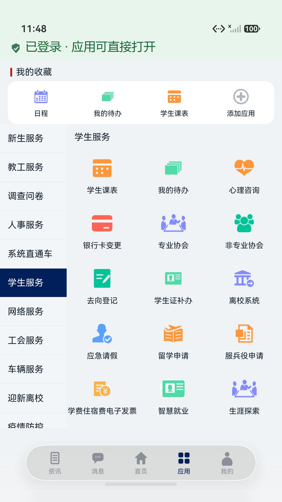
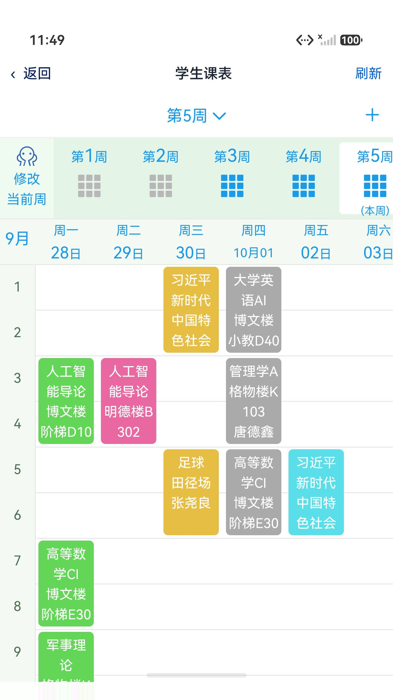
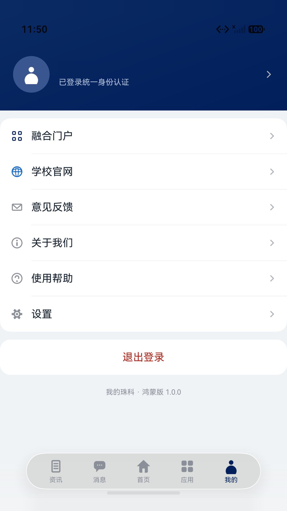
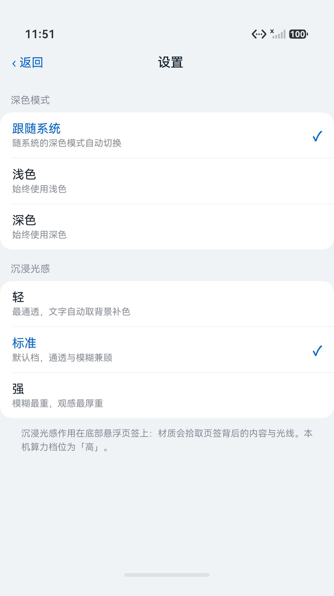
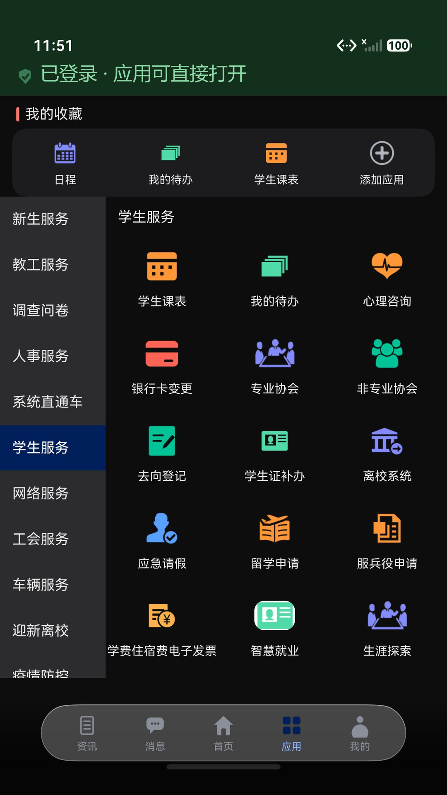
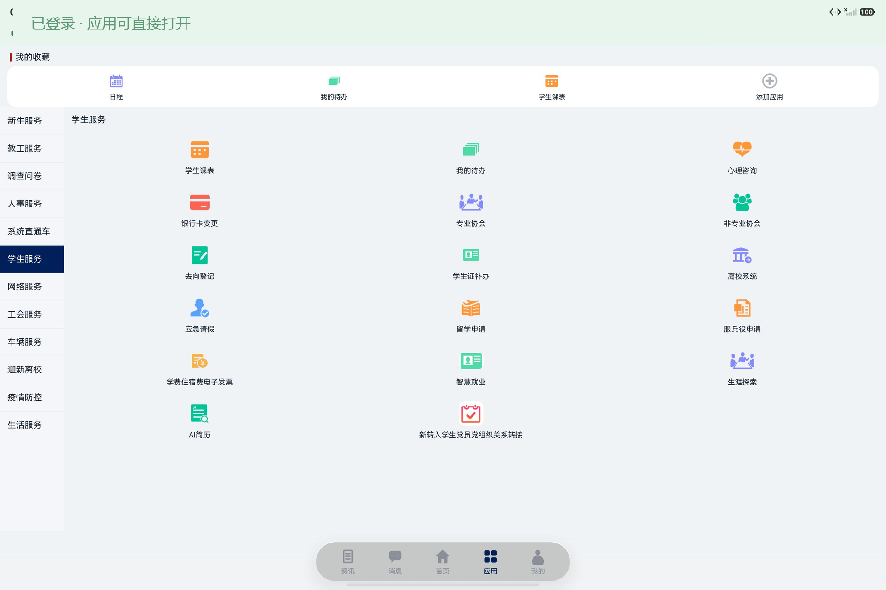
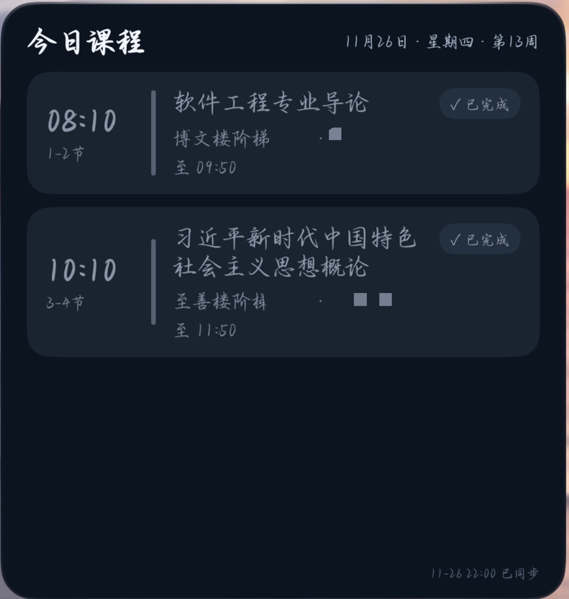
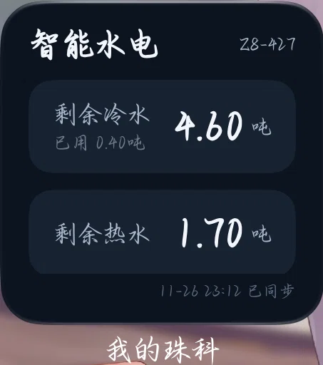

# 我的珠科 · 鸿蒙版

珠海科技学院校园门户的 HarmonyOS 原生客户端，使用 ArkTS + ArkUI 开发。
本仓库是 [MyZCST-For-HarmonyOS](https://github.com/hainuolangbuen-netizen/MyZCST-For-HarmonyOS) 的 fork。

当前版本：**1.0.9**（versionCode `1000009`，API 26）

[](https://developer.huawei.com/consumer/cn/)
[](https://developer.huawei.com/consumer/cn/arkts)
[](LICENSE)

底部为沉浸光感（Immersive Material）悬浮页签，支持桌面小组件、深色 / 浅色 / 跟随系统主题，
并通过校内统一身份认证（CAS）直接登录轻应用。

> 本项目是第三方非官方客户端，与珠海科技学院无隶属关系。应用内展示的资讯、通知、
> 应用入口、课表等内容均来自学校公开的网站与信息门户。

## 下载

| 版本 | 文件 | 大小 | SHA-256 |
| --- | --- | --- | --- |
| 1.0.9 | [MyZCST-1.0.9-unsigned.hap](https://github.com/xianyu-bxsj/MyZCST-For-HarmonyOS/releases/latest) | 1,072,691 字节 | `16E1E250CC6778243B9CF7ECBD6F41231DD0C8DC03A7690C9B81141F0B122070` |

Release 中的 HAP **未签名**，安装前需要自行签名，或使用带重签名能力的调试工具。

## 安装

方式一：自行签名后安装。

1. DevEco Studio 打开工程，`File → Project Structure → Signing Configs`，勾选
   `Automatically generate signature`；
2. 执行 Build，得到 `entry/build/default/outputs/default/entry-default-signed.hap`；
3. 手机开启「开发者选项 → USB 调试」，执行：

   ```bash
   hdc list targets
   hdc install -r entry/build/default/outputs/default/entry-default-signed.hap
   ```

   无线调试：`hdc tconn <IP>:<端口>` 后再执行安装。

方式二：使用调试工具安装。以下工具由第三方开发，与本项目无关：

- [小白调试助手（Auto-Installer）](https://github.com/likuai2010/auto-installer/releases/latest)：
  基于 hdc 的跨平台鸿蒙应用安装调试工具；
- [HoKit](https://github.com/yabi-zzh/HoKit/releases/latest)：
  设备投屏、性能监控、应用解析、重签名与文件管理。

## 本仓库的改动

| 模块 | 内容 |
| --- | --- |
| 今日课程卡片 | 显示时间、节次、课程、教室、教师、周次；下课后整卡变浅并标记「已完成」；支持卡片内滚动 |
| 我的待办卡片 | 同步门户待办，深色列表，支持滚动 |
| 智能水电卡片 | 显示剩余电量（度）与剩余冷水 / 热水（吨），不显示金额 |
| 登录 | 在 CAS 登录页识别学号，登录后可直接查询水电；设置页可手动修改 |
| 网页 | 附件下载到应用沙箱并用 Preview Kit 打开；首页与「添加应用」支持搜索 |
| 支付 | `weixin://`、`alipays://` 交由系统拉起对应应用，H5 收银台在浏览器打开 |
| 智能水电页 | 移除首屏自动刷新，避免一次性 `ST` 票据失效 |
| 主题 | 修正深色模式文字对比度；深色 + 沉浸光感「强」时页签改用深色材质与专用图标 |
| 图标 | 分层图标前景缩进安全区，校徽居中 |

上游功能与实现细节见[功能](#功能)、[亮点一：沉浸光感](#亮点一沉浸光感)、
[亮点二：桌面小组件](#亮点二桌面小组件)各节。

> 以上改动目前只在鸿蒙手机上验证，平板、折叠屏与电脑未测试。

## 截图

| 首页 | 应用中心 | 学生课表 | 个人中心 |
| :--: | :--: | :--: | :--: |
|  |  |  |  |

| 校园资讯 | 设置（含沉浸光感三档） | 应用（深色） | 首页（深色） |
| :--: | :--: | :--: | :--: |
|  |  |  |  |

平板（MatePad Pro 13，横屏）：



本仓库新增的桌面卡片：

| 今日课程 | 智能水电 |
| :--: | :--: |
|  |  |

## 功能

| 模块 | 说明 |
| --- | --- |
| 首页 | 轮播、悬浮搜索框、「我的收藏」快捷入口（与「应用」页联动）、卡片入口 |
| 应用 | 从学校门户接口拉取应用分类与全部应用（27 个），左侧分类栏 + 右侧宫格；可收藏（最多 4 个）、长按移除；图标直接使用服务端原图 |
| 应用详情 | 点击进入轻应用，统一身份认证（CAS）由系统 Web 组件完成，无需二次输入密码 |
| 资讯 | 学校官网的移动端页面 |
| 消息 | 学校通知公告、融合门户待办入口 |
| 我的 | 登录状态、融合门户、学校官网、意见反馈、关于、帮助、设置 |
| 设置 | 深色 / 浅色 / 跟随系统；沉浸光感 轻 / 标准 / 强 |
| 桌面小组件 | 今日课程、我的待办、智能水电，2×2 / 2×4 / 4×4；课程与待办自动同步，智能水电登录后使用学号查询 |

## 亮点一：沉浸光感

HarmonyOS 26 引入的 `uiMaterial.ImmersiveMaterial` 让控件以材质而非半透明色块的方式
浮在内容之上，背景会随下方内容变化。本项目把它用在了底部悬浮页签上。

三档强度在 `common/MaterialGate.ets` 里集中映射，用户可在「设置」里切换：

| 档位 | `ImmersiveStyle` | `materialColor`（浅色 / 深色） | `colorInvert` |
| --- | --- | --- | --- |
| 轻 | `ULTRA_THIN` | `#0F000000` / `#33000000` | `true` |
| 标准 | `REGULAR` | `#1F000000` / `#59000000` | — |
| 强 | `ULTRA_THICK` | `#33000000` / `#80000000` | — |

`materialColor` **必须带 alpha 通道**，否则不生效；`colorInvert` 只在 `THIN` / `ULTRA_THIN` 两档才有反应。

### 集成注意

1. **`module.json5` 必须先开开关**：`metadata` 里加 `"ohos.arkui.UIMaterial.state": "enable"`，
   否则 `ImmersiveMaterial` 静默失效且不报错。
2. **只有专用属性生效**。`CommonMethod.systemMaterial()` 可编译，但挂在页签上没有效果；
   起作用的是 `FloatingTabBarStyle.systemMaterial`（以及 `Navigation.title` 这类自带材质语义的属性）。
3. **同一层不能叠加自身背景**。给 `Tabs` 设了 `barBackgroundColor` / `barBackgroundBlurStyle`
   就必须让位，否则材质会被底盖住。
4. **材质色跟随主题**。固定为半透明白时，浅色页面下玻璃几乎不可见；改为资源化的
   `bar_frost_thin` / `bar_frost_standard` / `bar_frost_strong`（浅色为淡黑、深色为更实的黑）后正常。
   深色模式若使用白色，页签会明显偏亮。

### 材质生效的验证方式

在同一个静态页面上分别截取三档的截图做像素比对：页面内容像素完全一致，
差异全部落在悬浮页签区域内，该区域的平均绝对差随档位递增，说明材质确实在渲染。

主题切换走 `ability.setColorMode(ConfigurationConstant.ColorMode)`，注意两点：

- 必须在 `windowStage.loadContent` 的**回调里**调用，`onCreate` 阶段调会静默失败；
- 优先级是 **UIAbility > ApplicationContext > 系统设置**，App 一旦自行设置过就不再跟随系统，
  需将模式设回 `COLOR_MODE_NOT_SET` 才能恢复。

## 亮点二：桌面小组件

三张卡片：**今日课程**、**我的待办**、**智能水电**，支持 2×2 / 2×4 / 4×4 三种尺寸，
配置在 `entry/src/main/resources/base/profile/form_config.json`，
数据经 `EntryFormAbility` 从 preferences（`common/CardStore.ets`）读取。
登录成功后 `CourseSync` / `TodoSync` 会自动同步课程与待办；`FeeSync` 在设置学号后
查询完美校园的宿舍水电余额，并主动刷新已添加的卡片。

写卡片时有三条约束：

- 卡片进程没有网络，也不能使用 `setTimeout`，数据需由 `FormExtensionAbility` 预先算好并写入 `formBindingData`；
- 只有带 `@form` 标记的 API 可用，`ImmersiveMaterial` 不在其中，因此小组件无法使用沉浸光感；
- 卡片不能依赖 HSP，逻辑需内联或放入 HAR。

## 环境要求

| 项目 | 版本 |
| --- | --- |
| HarmonyOS SDK | API 26（`compatibleSdkVersion` / `targetSdkVersion` = `26.0.0`） |
| DevEco Studio | 26.0.0.851（构建号 `261.23567.138.36.2600851`） |
| hvigor / modelVersion | `6.26.8` |
| JDK | 21（DevEco 自带 jbr） |

> 沉浸光感用到的 `uiMaterial.ImmersiveMaterial`、`FloatingTabBarStyle.systemMaterial`、
> `barFloatingStyle` 均为 `@since 26.0.0`，低版本 SDK 无法编译；如需兼容低版本，只能移除该层实现。

## 快速开始

```bash
git clone https://github.com/xianyu-bxsj/MyZCST-For-HarmonyOS.git
cd MyZCST-For-HarmonyOS
```

用 DevEco Studio 打开工程根目录（不是 `entry/`），等待 Sync 完成后运行。

命令行构建（Windows，脚本会调用 DevEco 自带的 hvigor / node / SDK）：

```powershell
powershell -NoProfile -ExecutionPolicy Bypass -File .\build-hap.ps1
# 可选参数：-BuildMode release、-Clean、-DevEcoHome "D:\...\DevEco Studio"
```

仓库没有提交 `hvigorw` 包装脚本，所以直接执行 `hvigorw` 需要 DevEco 的终端环境（或手动把
`<DevEco>/tools/hvigor/bin` 加进 PATH）；上面的脚本免去这一步，并把 hvigor 缓存固定到
工程内 `.hvigor-home/`（已加入 `.gitignore`）。

产物在 `entry/build/default/outputs/default/`。上架用的发布包（`.app`）在 DevEco 里
`Build → Build App(s)` 生成，或使用 DevEco 内置 hvigor：

```powershell
<DevEco>\tools\node\node.exe <DevEco>\tools\hvigor\bin\hvigorw.js assembleApp -p product=default -p buildMode=release
```

### 签名

仓库里的 `build-profile.json5` 将 `signingConfigs` 留空，因为签名口令不适合提交到仓库。

本地怎么跑起来：

1. DevEco Studio → `File` → `Project Structure` → `Signing Configs`
2. 勾上 **Automatically generate signature**，登录华为开发者账号
3. DevEco 会自动申请调试证书、把你的设备 UDID 注册进 Profile，并回填 `build-profile.json5`

要出正式包，就把 `signingConfigs` 换成你自己的发布证书（`.p12` / `.cer` / `.p7b`），
并让 `products[].signingConfig` 指向那个配置名。

> `.gitignore` 已经把 `*.p12`、`*.cer`、`*.p7b`、`build-profile.local.json5` 全部排除，
> 提交前请 `git status` 再确认一次。

## 装到真机

HarmonyOS 没有侧载入口，在文件管理器里点击 `.hap` 不会触发安装。
官方安装方式是 `hdc`：

```bash
# 1. 手机打开「开发者选项 → USB 调试」，插线，确认设备已识别
hdc list targets

# 2. 安装（-r 表示覆盖安装）
hdc install -r entry/build/default/outputs/default/entry-default-signed.hap

# 3. 拉起
hdc shell aa start -a EntryAbility -b com.zcst.myzcst
```

无线调试（手机和电脑同一局域网）：手机上开「开发者选项 → 无线调试」，
拿到 IP 和端口后 `hdc tconn 192.168.x.x:端口`，之后用法和 USB 完全一样。

> `.hap` 是单个模块的包，用于本地调试与侧载；`.app` 是整个应用的集合包，上架 AppGallery 时提交。

也可以用[安装](#安装)一节提到的第三方调试工具（小白调试助手 / HoKit）安装，
不必先装 DevEco；这些工具由第三方维护，与本项目无关。

### 常见错误

| 报错 | 原因 | 解法 |
| --- | --- | --- |
| `code:9568322 error: signature verification failed due to not trusted app source.` | 装的是发布证书签的包，发布签名不能侧载 | 用调试签名重新打包（调试 Profile 的白名单需包含本机 UDID）后再 `hdc install` |
| `Error Code:10106102 The device screen is locked during the application launch` | 手机锁屏时不允许拉起应用 | 解锁屏幕再执行 |

## 工程结构

```
myzcst-harmony/
├── AppScope/                          应用级配置与分层图标（background / foreground）
├── entry/
│   └── src/main/
│       ├── ets/
│       │   ├── common/                会话、网络、设置、材质、卡片同步等公共模块
│       │   │   ├── PortalConfig.ets       所有校内地址常量
│       │   │   ├── PortalApi.ets          门户 JSON 接口调用与容错解析
│       │   │   ├── AppData.ets            应用目录内存缓存 + 收藏持久化
│       │   │   ├── AppSettings.ets        主题 / 沉浸光感强度，读写 preferences
│       │   │   ├── Session.ets            登录态与用户显示名
│       │   │   ├── StudentBridge.ets      从 CAS 登录页识别学号
│       │   │   ├── MaterialGate.ets       沉浸光感材质封装（三档）
│       │   │   ├── CardStore.ets          桌面小组件的数据存取
│       │   │   ├── CardData.ets           卡片绑定数据与主动刷新
│       │   │   ├── CourseSync.ets         今日课程同步
│       │   │   ├── TodoSync.ets           待办同步
│       │   │   ├── FeeSync.ets            智能水电查询
│       │   │   ├── WaterBridge.ets        智能水电页面读数兜底
│       │   │   ├── WebLink.ets            站外链接与支付 Scheme
│       │   │   ├── Downloader.ets         网页附件下载
│       │   │   ├── RouteParams.ets        页面间参数
│       │   │   └── Ui.ets                 UIContext 封装（toast / 路由 / 上下文）
│       │   ├── entryability/          UIAbility
│       │   ├── entryformability/      桌面小组件的 FormExtensionAbility
│       │   ├── pages/                 @Entry 页面：Index / LoginPage / SettingsPage / WebViewPage
│       │   ├── view/                  TabContent 子组件：HomePage / AppPage / MessagePage / MinePage / WebTab
│       │   └── widget/pages/          三张卡片：ScheduleCard / TodoCard / FeeCard
│       └── resources/                 颜色（含 dark/）、字符串、32 张自绘 PNG、form_config
├── build-profile.json5
└── oh-package.json5
```

分层图标（`AppScope` 与 `entry` 各一份）：`background` 铺满整块且不透明；
`foreground` 透明底，主体放在中间约 62% 的安全区内，圆角遮罩由系统套用。

## 数据来源

移动门户接口部署在 `https://my.zcst.edu.cn/mobile/*.mo`：

| 接口 | 是否需要登录 | 用途 |
| --- | --- | --- |
| `getAppCategorys.mo` | 否 | 12 个应用分类 |
| `queryCategoryApps.mo` | 是 | 返回全部 27 个应用（服务端忽略 `categoryId`，客户端按应用自带的 `categoryIds` 本地过滤） |
| `listAnonNavigation15.mo` | 否 | 匿名导航栏目 |

集成注意事项：

- 应用入口地址字段为 `mainUrl`，不是 `url` / `appUrl`；`downloadUrl`、`installUrl` 指向离线包，不可用。
- 显示名在 `name` / `title` 中，`appName` 是包名（形如 `com.sudytech.xxx`）。
- 图标是 `http://` 明文链接，交给 `Image` 前需改写为 `https://`，否则会被网络安全策略拦截。
- 未登录访问 `queryCategoryApps.mo` 会 302 到 `https://sos.zcst.edu.cn/login?service=...`。
- 匿名接口返回 `{"data":...,"reason":"","result":"1"}`，`result:"0"` 表示失败，不能只判断 `data` 是否存在。
- 跨域单点登录：原生 `@ohos.net.http` 不会自行完成 CAS 跳转。先发起原生 HTTP 请求，
  若返回 HTML（说明被 302 到登录页），再用一次隐藏的 `Web` 组件访问同一地址，
  由 WebView 完成 CAS 并取得会话 Cookie，之后回到原生 HTTP，
  Cookie 由 `webview.WebCookieManager.fetchCookieSync()` 携带。

> 早期版本用「隐藏 Web 组件 + `runJavaScript` 读取 `document.body.innerText`」取数据，
> 切换分类时会触发 ArkWeb 网络线程 `SIGTRAP` 崩溃（栈位于 `libarkweb_engine.so` 的 `NetworkService`）。
> 不建议再用这种方式反复 `loadUrl` 获取接口数据。

## 已知限制

已完成：

- 网页附件下载：`onDownloadStart` → `@ohos.request` 下载到应用沙箱 `filesDir/downloads/`，
  完成后用 Preview Kit 打开
- 「添加应用」面板与首页搜索框支持按应用名过滤
- 桌面小组件点击直达：课表卡片 → 官方课表轻应用，待办卡片 → PC 融合门户
- 今日课程、我的待办登录后自动同步
- 智能水电显示剩余电量（度）与剩余水量（吨）
- 深色模式文字对比度、水电缴费白屏、卡片内滚动

尚未解决：

- 应用列表接口没有公开文档，字段靠运行时探测，学校改版可能失效
- 仅在鸿蒙手机上验证，平板、折叠屏与电脑未测试
- 智能水电依赖完美校园 `SWAEServlet`，部分网络或账号会被 405 拦截
- 学号自动识别依赖 CAS 登录页表单结构，识别不到时需在设置里手动填写

> 附件保存在应用沙箱内，卸载应用时由系统清理，不会写入公共「下载」目录。

## 常见问题

**装不上，报 `9568322`？**
安装的是发布证书签名的包。发布签名不能侧载，需用调试签名重新打包，详见[安装](#安装)。

**能否降级到 API 20？**
不能。沉浸光感相关 API 为 `@since 26.0.0`，除非移除该层实现。

**改了主题后不再跟随系统？**
`setColorMode` 设置过之后会覆盖系统设置，把模式设回 `COLOR_MODE_NOT_SET` 可恢复跟随。

**登录密码会被保存吗？**
不会。密码只在学校的 `sos.zcst.edu.cn` 页面提交，应用不读取明文、不保存密码，
会话凭据保存在系统 WebView 的 Cookie 中。

## 免责声明

1. 本仓库是 [MyZCST-For-HarmonyOS](https://github.com/hainuolangbuen-netizen/MyZCST-For-HarmonyOS)
   的 fork，原始代码与设计的版权归上游作者所有。
2. 本项目是第三方非官方客户端，与珠海科技学院无隶属、代理或合作关系，
   展示内容均来自学校公开的网站与信息门户，不对其准确性与时效性作保证。
3. 应用不收集、不上传个人信息，也没有开发者服务器；登录凭据直接提交给学校统一身份认证，
   应用不读取明文、不保存密码；水电查询使用的学号仅保存在本机。
4. 课表、待办、智能水电等接口均无公开文档，可能随时变更或失效。
5. 校徽、校名等标识的知识产权归珠海科技学院所有，如权利人提出异议会立即移除。
6. 本仓库的改动仅在手机上验证，其它设备形态与使用后果由使用者自行承担。

## 许可

代码部分见 [LICENSE](LICENSE)，采用 MIT。
`entry/src/main/resources/base/media/` 与 `AppScope/resources/base/media/` 下的校徽相关图标不在开源许可范围内。
