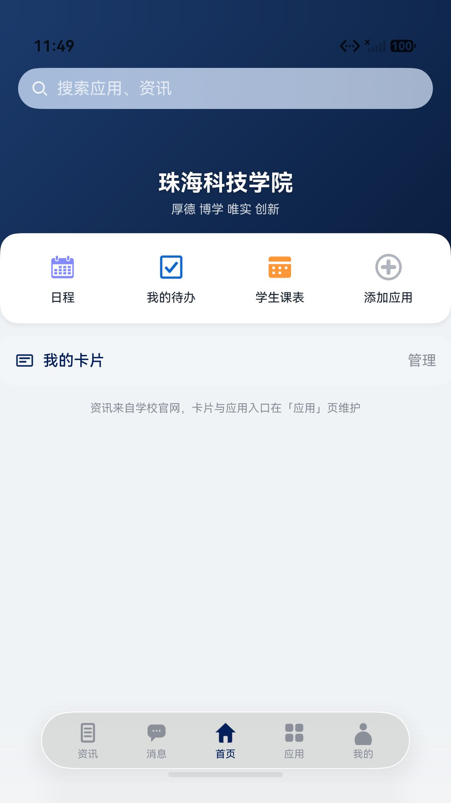
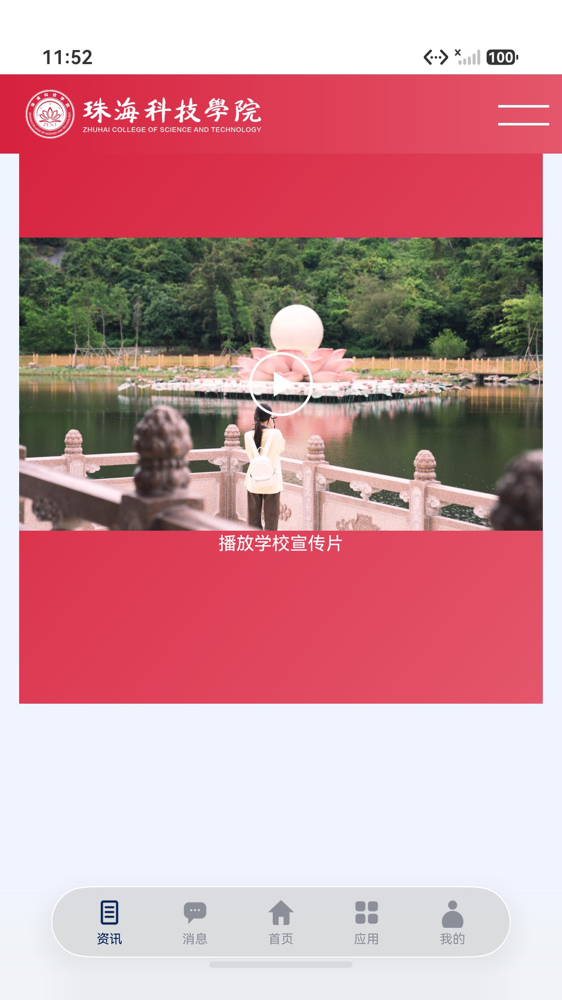
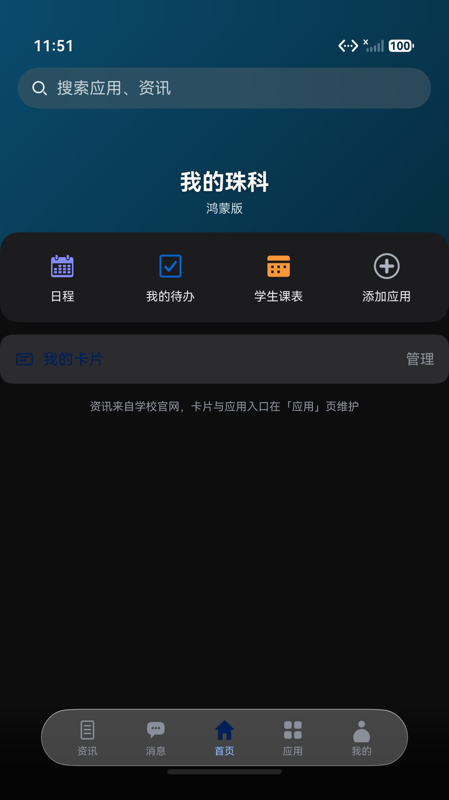

# 我的珠科 · 鸿蒙版（二次开发）

> 珠海科技学院校园门户的 **HarmonyOS 原生客户端**，用 ArkTS + ArkUI 重写。
> 本仓库 fork 自 [hainuolangbuen-netizen/MyZCST-For-HarmonyOS](https://github.com/hainuolangbuen-netizen/MyZCST-For-HarmonyOS)，
> 当前版本：**1.0.9**（versionCode `1000009`，API 26）。

[](https://developer.huawei.com/consumer/cn/)
[](https://developer.huawei.com/consumer/cn/arkts)
[](LICENSE)

用上了系统级的 **沉浸光感**（Immersive Material）悬浮页签、**桌面小组件**、深色 / 浅色 / 跟随系统三态主题，
以及校内统一身份认证（CAS）免密直通。

> ⚠️ **第三方非官方客户端**：本项目由学生个人维护，不由珠海科技学院发布，也不代表学校立场。
> 应用内的资讯、通知、应用入口、课表等内容均来自学校公开的官方网站与信息门户。

---

## 目录

- [这个仓库是什么](#这个仓库是什么)
- [本仓库改了什么](#本仓库改了什么)
- [下载与安装](#下载与安装)
- [截图](#截图)
- [功能](#功能)
- [亮点一：沉浸光感](#亮点一沉浸光感)
- [亮点二：桌面小组件](#亮点二桌面小组件)
- [环境要求](#环境要求)
- [快速开始](#快速开始)
- [装到真机](#装到真机)
- [工程结构](#工程结构)
- [数据是从哪来的](#数据是从哪来的)
- [已知限制](#已知限制欢迎-pr)
- [常见问题](#常见问题)
- [免责声明](#免责声明)
- [许可](#许可)

## 这个仓库是什么

- **上游**：[hainuolangbuen-netizen/MyZCST-For-HarmonyOS](https://github.com/hainuolangbuen-netizen/MyZCST-For-HarmonyOS)，
  提供整个 ArkTS/ArkUI 工程骨架、沉浸光感页签与基础页面，原始代码的版权归上游作者。
- **本仓库**：上游的 fork，在 `main` 上叠加了下面列出的改动，并打 Release 供直接安装。
- 上游仍在演进，本仓库只保证自己 Release 里的包可用；与上游的差异见 PR
  [#1](https://github.com/hainuolangbuen-netizen/MyZCST-For-HarmonyOS/pull/1)。

## 本仓库改了什么

| 模块 | 改动 |
| --- | --- |
| 今日课程卡片 | 参考掌上猪科样式重做：时间/节次/课程/教室/教师/周次；下课后整卡变浅并显示「✓ 已完成」；`List` 支持卡片内滚动；登录后自动同步 |
| 我的待办卡片 | 接入门户待办接口，深色列表卡，支持滚动，无待办显示「暂无待办」 |
| 智能水电卡片 | `getbindroom` 取房间后调 `h5_getstuindexpage.modlist`，显示剩余电量（度）与剩余冷水/热水（吨），不再显示价格行；完美校园失败时可从应用内智能水电页面读取 |
| 登录 | CAS 登录页自动识别 6~20 位数字学号，登录返回即可查询水电；设置页仍可手动修正 |
| 网页 | 附件下载到沙箱并用 Preview Kit 打开；首页搜索、添加应用搜索 |
| 支付 | `weixin://` / `alipays://` 直接 `startAbility` 拉起 App，H5 收银台才交给浏览器；修复水电缴费白屏与「商家格式有误」常见路径 |
| 智能水电页 | 移除首屏自动刷新，避免一次性 `ST` 票根失效（「未能识别出目标…票根」） |
| 主题 | 深色模式对比度；深色 + 沉浸光感「强」时页签改深色玻璃，深色专用页签图标 |
| 图标 | 分层图标前景缩进安全区，校徽居中 |

> **验证范围**：以上改动目前只在**鸿蒙手机**上验证过；
> 平板、折叠屏、电脑等其它形态没有实测，可能存在布局或材质差异。

## 下载与安装

- 最新包：[Releases · v1.0.9](https://github.com/xianyu-bxsj/MyZCST-For-HarmonyOS/releases/latest)
- 文件：`MyZCST-1.0.9-unsigned.hap`（1,072,691 字节）
- SHA-256：`16E1E250CC6778243B9CF7ECBD6F41231DD0C8DC03A7690C9B81141F0B122070`

Release 里的是**未签名** HAP，直接 `hdc install` 会报签名错误。两条路：

1. **自己签名**：DevEco Studio → `File → Project Structure → Signing Configs`
   勾选 `Automatically generate signature`，重新 Build 出 `entry-default-signed.hap` 再装（见[装到真机](#装到真机)）。
2. **用调试安装工具**：社区里常用的两款跨平台工具，可以省掉装 DevEco 的步骤 ——
   - [小白调试助手 Auto-Installer](https://github.com/likuai2010/auto-installer/releases/latest)：
     免费、跨平台的鸿蒙应用安装/调试工具，填设备连接信息后直接装 HAP；
   - [HoKit](https://github.com/yabi-zzh/HoKit/releases/latest)：
     设备投屏、性能监控、应用解析、**一键重签名**、文件管理等，带重签名功能，适合装未签名包。

   > 两款都是第三方工具，与本项目无关，使用前请自行确认来源与权限；
   > 参考用法见 [Zitann/HarmonyOS-Haps](https://github.com/Zitann/HarmonyOS-Haps) 的「安装工具」一节。

## 截图

| 首页 | 应用中心 | 学生课表 | 个人中心 |
| :--: | :--: | :--: | :--: |
|  |  |  |  |

| 校园资讯 | 设置（含沉浸光感三档） | 应用（深色） | 首页（深色） |
| :--: | :--: | :--: | :--: |
|  |  |  |  |

平板（MatePad Pro 13，横屏）：


### 本分支新增功能截图

| 今日课程卡片（已完成变浅 + 滚动） | 智能水电卡片（剩余电量/水量） |
| :--: | :--: |
|  |  |

> 截图来自本分支的桌面小组件：课程卡显示时间、节次、课程、教室/教师/周次、
> 下课时间与完成状态；智能水电卡显示剩余冷水/热水（吨），不再显示价格行。

## 功能

| 模块 | 说明 |
| --- | --- |
| **首页** | 轮播、悬浮搜索框、「我的收藏」快捷入口（与「应用」页联动）、卡片入口 |
| **应用** | 从学校门户接口拉取真实的应用分类与全部应用（27 个），左侧分类栏 + 右侧宫格；可收藏（最多 4 个）、长按移除；图标直接用服务端原图 |
| **应用详情** | 点击进入轻应用，统一身份认证（CAS）由系统 Web 组件自动完成，无需二次输入密码 |
| **资讯** | 学校官网的移动端页面 |
| **消息** | 学校通知公告、融合门户待办入口 |
| **我的** | 登录状态、融合门户、学校官网、意见反馈、关于、帮助、设置 |
| **设置** | 深色 / 浅色 / 跟随系统；沉浸光感 轻 / 标准 / 强 |
| **桌面小组件** | 今日课程、我的待办、智能水电，2×2 / 2×4 / 4×4；课程/待办自动同步，智能水电登录后自动识别学号并读取剩余电量/水量 |

## 亮点一：沉浸光感

HarmonyOS 26 引入的 `uiMaterial.ImmersiveMaterial` 能让控件以"材质"而非"半透明色块"的方式
浮在内容之上 —— 背景会实时折射、随滚动流动。本项目把它用在了底部悬浮页签上。

三档强度在 `common/MaterialGate.ets` 里集中映射，用户可在「设置」里切换：

| 档位 | `ImmersiveStyle` | `materialColor`（浅色 / 深色） | `colorInvert` |
| --- | --- | --- | --- |
| 轻 | `ULTRA_THIN` | `#0F000000` / `#33000000` | `true` |
| 标准 | `REGULAR` | `#1F000000` / `#59000000` | — |
| 强 | `ULTRA_THICK` | `#33000000` / `#80000000` | — |

`materialColor` **必须带 alpha 通道**，否则不生效；`colorInvert` 只在 `THIN` / `ULTRA_THIN` 两档才有反应。

### 踩过的坑（这部分花的时间最多）

1. **`module.json5` 必须先开开关**：`metadata` 里加 `"ohos.arkui.UIMaterial.state": "enable"`，
   否则 `ImmersiveMaterial` 静默失效，不报错。
2. **只有"专用属性"才真的生效**。`CommonMethod.systemMaterial()` 谁都调得到、也能编译通过，
   但在页签栏上**什么都不会发生**。真正管用的是 `FloatingTabBarStyle.systemMaterial`
   （以及 `Navigation.title` 这类本身就带材质语义的属性）。
3. **同一层不能叠自己的背景**。给 `Tabs` 设了 `barBackgroundColor` / `barBackgroundBlurStyle`
   就必须让位，否则材质被自己的底盖住。
4. **材质色要跟着主题走**。一开始把 `materialColor` 写死成半透明白，
   浅色模式下页面本身接近白色 → 玻璃几乎看不见。改成资源化的
   `bar_frost_light` / `bar_frost_dark`（浅色下是极淡的黑，深色下是极淡的白）之后才正常。

### 怎么验证它真的生效了

光靠肉眼看容易自我催眠，我们用像素级 A/B 比过：在同一个静态页面（我的）上分别截三档的图，
**页面内容像素完全一致**（`top mean = 0.000`），差异全部落在悬浮页签的包围盒
`x=[120,1199] y=[2016,2191]` 内；该条带内的平均绝对差为 **9.57**（轻 vs 标准）、
**19.42**（标准 vs 强）、**28.85**（轻 vs 强），单调递增 —— 说明确实在渲染材质，而不是没反应。

主题切换走 `ability.setColorMode(ConfigurationConstant.ColorMode)`，注意两点：

- 必须在 `windowStage.loadContent` 的**回调里**调用，`onCreate` 阶段调会静默失败；
- 优先级是 **UIAbility > ApplicationContext > 系统设置**，所以 App 一旦自己设过就再也跟随不了系统，
  想恢复跟随要把模式设回 `COLOR_MODE_NOT_SET`。

## 亮点二：桌面小组件

三张卡片：**今日课程**、**我的待办**、**智能水电**，支持 2×2 / 2×4 / 4×4 三种尺寸，
配置在 `entry/src/main/resources/base/profile/form_config.json`，
数据经 `EntryFormAbility` 从 preferences（`common/CardStore.ets`）读取。
登录成功后 `CourseSync` / `TodoSync` 会自动同步课程与待办；`FeeSync` 在设置学号后
查询完美校园的宿舍水电余额，并主动刷新已添加的卡片。

写卡片时有三条硬约束，踩过就知道：

- **卡片进程里没有网络**，也不能用 `setTimeout`，所有数据必须由 `FormExtensionAbility` 预先算好塞进 `formBindingData`；
- **只有 `@form` 标记过的 API 能用**，`ImmersiveMaterial` 不在其中 —— 所以小组件用不了沉浸光感；
- **卡片不能依赖 HSP**，逻辑要么内联要么放 HAR。

## 环境要求

| 项目 | 版本 |
| --- | --- |
| HarmonyOS SDK | **API 26**（`compatibleSdkVersion` / `targetSdkVersion` = `26.0.0`，本机装的 SDK 是 `26.0.0.105`） |
| DevEco Studio | **26.0.0.851**（构建号 `261.23567.138.36.2600851`） |
| hvigor / modelVersion | `6.26.8` |
| JDK | 21（DevEco 自带 jbr） |

> **为什么必须是 API 26**：沉浸光感用到的 `uiMaterial.ImmersiveMaterial`、
> `FloatingTabBarStyle.systemMaterial`、`barFloatingStyle` 全部是 `@since 26.0.0`，
> 低版本 SDK 里根本没有这些声明，无法向下兼容。想跑在低版本上，只能先把这一层删掉。

## 快速开始

```bash
git clone https://github.com/hainuolangbuen-netizen/MyZCST-For-HarmonyOS.git
cd MyZCST-For-HarmonyOS
```

然后用 DevEco Studio **打开工程根目录**（不是 `entry/`），等 Sync 完成后点 Run。

命令行构建（Windows，脚本会调用 DevEco 自带的 hvigor / node / SDK）：

```powershell
powershell -NoProfile -ExecutionPolicy Bypass -File .\build-hap.ps1
# 可选参数：-BuildMode release、-Clean、-DevEcoHome "D:\...\DevEco Studio"
```

仓库没有提交 `hvigorw` 包装脚本，所以直接执行 `hvigorw` 需要 DevEco 的终端环境（或手动把
`<DevEco>/tools/hvigor/bin` 加进 PATH）；上面的脚本免去这一步，并把 hvigor 缓存固定到
工程内 `.hvigor-home/`（已加入 `.gitignore`）。

产物在 `entry/build/default/outputs/default/`。上架用的发布包（`.app`）在 DevEco 里
`Build → Build App(s)` 生成，或使用 DevEco 内置 hvigor：

```powershell
<DevEco>\tools\node\node.exe <DevEco>\tools\hvigor\bin\hvigorw.js assembleApp -p product=default -p buildMode=release
```

### 签名

仓库里的 `build-profile.json5` **故意把 `signingConfigs` 留空**，因为签名口令不能进 Git。

本地怎么跑起来：

1. DevEco Studio → `File` → `Project Structure` → `Signing Configs`
2. 勾上 **Automatically generate signature**，登录华为开发者账号
3. DevEco 会自动申请调试证书、把你的设备 UDID 注册进 Profile，并回填 `build-profile.json5`

要出正式包，就把 `signingConfigs` 换成你自己的发布证书（`.p12` / `.cer` / `.p7b`），
并让 `products[].signingConfig` 指向那个配置名。

> `.gitignore` 已经把 `*.p12`、`*.cer`、`*.p7b`、`build-profile.local.json5` 全部排除，
> 提交前请 `git status` 再确认一次。

## 装到真机

HarmonyOS **没有侧载入口** —— 在文件管理器里点 `.hap` 不会有任何反应。
官方安装方式就是 `hdc`（DevEco 的 Run 按钮底层也是它）：

```bash
# 1. 手机打开「开发者选项 → USB 调试」，插线，确认设备已识别
hdc list targets

# 2. 安装（-r 表示覆盖安装）
hdc install -r entry/build/default/outputs/default/entry-default-signed.hap

# 3. 拉起
hdc shell aa start -a EntryAbility -b com.zcst.myzcst
```

无线调试（手机和电脑同一局域网）：手机上开「开发者选项 → 无线调试」，
拿到 IP 和端口后 `hdc tconn 192.168.x.x:端口`，之后用法和 USB 完全一样。

> `.hap` 和 `.app` 的区别：**`.hap`** 是单个模块的包，用于本地调试 / 侧载；
> **`.app`** 是整个应用的集合包，是**上架 AppGallery 时要提交**的那个格式。

也可以用[下载与安装](#下载与安装)里提到的第三方调试工具（小白调试助手 / HoKit）安装，
不必先装 DevEco；但它们与本项目无关，且**不会**替你把包签成你自己的证书，
发布证书签的包仍然只能走应用市场。

### 两个最容易撞上的错误

| 报错 | 原因 | 解法 |
| --- | --- | --- |
| `code:9568322 error: signature verification failed due to not trusted app source.` | 装的是**发布证书签的包**。发布签名的包只能走应用市场安装，**不能侧载** | 换调试签名重打一个包：调试 Profile 里白名单包含本机 UDID，这样才能 `hdc install` |
| `Error Code:10106102 The device screen is locked during the application launch` | 手机锁屏时不允许拉起应用 | 解锁屏幕再执行 |

## 工程结构

```
myzcst-harmony/
├── AppScope/                          应用级配置与分层图标（background / foreground）
├── entry/
│   └── src/main/
│       ├── ets/
│       │   ├── common/                会话、网络、设置、材质等公共模块
│       │   │   ├── PortalConfig.ets       所有校内地址常量
│       │   │   ├── PortalApi.ets          门户 JSON 接口调用与容错解析
│       │   │   ├── AppData.ets            应用目录内存缓存 + 收藏持久化
│       │   │   ├── AppSettings.ets        主题 / 沉浸光感强度，读写 preferences
│       │   │   ├── Session.ets            登录态与用户显示名
│       │   │   ├── MaterialGate.ets       沉浸光感材质封装（三档）
│       │   │   ├── CardStore.ets          桌面小组件的数据存取
│       │   │   ├── RouteParams.ets        页面间参数
│       │   │   └── Ui.ets                 UIContext 封装（toast / 路由 / 上下文）
│       │   ├── entryability/          UIAbility
│       │   ├── entryformability/      桌面小组件的 FormExtensionAbility
│       │   ├── pages/                 @Entry 页面：Index / LoginPage / SettingsPage / WebViewPage
│       │   ├── view/                  TabContent 子组件：HomePage / AppPage / MessagePage / MinePage / WebTab
│       │   └── widget/pages/          两张卡片：ScheduleCard / TodoCard
│       └── resources/                 颜色（含 dark/）、字符串、32 张自绘 PNG、form_config
├── build-profile.json5
└── oh-package.json5
```

分层图标（`AppScope` 与 `entry` 各一份）约定：`background` 铺满整块、**必须不透明**；
`foreground` 透明底，主体放在**中间约 62% 的安全区**内，圆角遮罩由系统套。

## 数据是从哪来的

学校的移动门户接口部署在 `https://my.zcst.edu.cn/mobile/*.mo`：

| 接口 | 是否需要登录 | 用途 |
| --- | --- | --- |
| `getAppCategorys.mo` | 否 | 12 个应用分类 |
| `queryCategoryApps.mo` | **是** | 返回全部 27 个应用（服务端忽略 `categoryId`，客户端按每个应用自带的 `categoryIds` 本地过滤） |
| `listAnonNavigation15.mo` | 否 | 匿名导航栏目 |

几个踩过的坑，写在这里省得后面的人再踩：

- 应用入口地址字段是 **`mainUrl`**，不是 `url` / `appUrl`；`downloadUrl`、`installUrl` 是离线包，不能用。
- 显示名在 `name` / `title`，**`appName` 是包名**（形如 `com.sudytech.xxx`）。
- 图标是 `http://` 明文链接，交给 `Image` 之前要改写成 `https://`，否则会被网络安全策略拦掉。
- 未登录访问 `queryCategoryApps.mo` 会 302 到 `https://sos.zcst.edu.cn/login?service=...`。
- 匿名接口的返回是 `{"data":...,"reason":"","result":"1"}`，**`result:"0"` 表示失败**，别只看有没有 `data`。
- 跨域单点登录：原生 `@ohos.net.http` 不会自己完成 CAS 跳转。做法是先用原生 HTTP 请求，
  如果拿到的是 HTML（说明被 302 到登录页），再借一次隐藏的 `Web` 组件访问同一地址，
  让 WebView 走完 CAS 拿到会话 Cookie，之后回到原生 HTTP —— Cookie 由
  `webview.WebCookieManager.fetchCookieSync()` 自动携带。

> ⚠️ 早期版本用「隐藏 Web 组件 + `runJavaScript` 读 `document.body.innerText`」取数据，
> 切分类时会触发 ArkWeb 网络线程 `SIGTRAP` 崩溃（栈全在 `libarkweb_engine.so` 的 `NetworkService`）。
> **不要再用这种方式反复 `loadUrl` 去取接口数据。**

## 已知限制（欢迎 PR）

- [x] 网页附件下载：`onDownloadStart` → `@ohos.request` 下载到应用沙箱 `filesDir/downloads/`，
  完成后用 Preview Kit 打开；系统不支持预览的格式会提示文件名
- [x] 「添加应用」面板支持按应用名搜索
- [x] 首页搜索框可用：按名称过滤应用目录，点结果直接打开对应应用
- [x] 桌面小组件点击直达：课表卡片 → 官方课表轻应用，待办卡片 → PC 融合门户
- [x] 今日课程数据：登录成功后自动同步（依赖学校旧移动接口，接口改版会失效，见
  [docs/BUGFIX-2026-11-26.md](docs/BUGFIX-2026-11-26.md)）
- [x] 我的待办数据：登录后从门户待办接口同步，卡片支持滚动
- [x] 智能水电数据：打开应用内智能水电页面读取剩余电量（度）/剩余水量（吨）
- [x] 深色模式可读性：新增 `brand_navy_text` 等深色专用色，修复「我的卡片」标题与返回按钮对比度
- [x] 水电缴费白屏：拦截支付 Scheme 与收银台弹窗，不再把当前页替换成空白页
- [ ] 应用列表接口没有公开文档，字段靠运行时探测，学校改版可能会失效
- [ ] **只在鸿蒙手机上验证过**；平板、折叠屏、电脑等形态没有实测，布局与沉浸光感可能有差异
- [ ] 智能水电走完美校园 `SWAEServlet`（未公开文档），部分网络/账号会被 405 风控
- [ ] 学号自动识别依赖 CAS 登录页输入框结构，识别不到时需在设置里手动填一次

> 附件保存在应用沙箱内，卸载应用时由系统清理，不会写入公共「下载」目录；
> 需要分享到其它应用时，可在系统预览窗口中操作。

## 常见问题

**Q：为什么装不上，报 `9568322`？**
你装的是发布证书签的包。发布签名的包不能侧载，只能用调试签名重新打一个，见[装到真机](#装到真机)。

**Q：能不能降级到 API 20 让老机型也能装？**
不能，除非把沉浸光感整层删掉。相关 API 是 `@since 26.0.0` 的。

**Q：改了主题之后为什么不再跟随系统了？**
`setColorMode` 一旦被 App 设过就会覆盖系统设置。要恢复跟随，把模式设回 `COLOR_MODE_NOT_SET`。

**Q：登录密码会被这个 App 存下来吗？**
不会。密码只在学校的 `sos.zcst.edu.cn` 页面里提交，应用不读取明文、不保存密码，
会话凭据保存在系统 WebView 的 Cookie 里。

## 免责声明

1. 本仓库是 [hainuolangbuen-netizen/MyZCST-For-HarmonyOS](https://github.com/hainuolangbuen-netizen/MyZCST-For-HarmonyOS)
   的 fork，基于原项目二次开发；原始代码与设计的版权归上游作者所有，本仓库只对自己新增/修改的部分负责。
2. 本应用是**第三方非官方客户端**，与珠海科技学院无隶属、代理或合作关系。
3. 应用内展示的所有内容（资讯、通知、课表、应用入口、水电读数等）均来自学校公开的网站与信息门户，
   不对其准确性、完整性与时效性做任何保证；充值、缴费等涉及资金的操作请以学校官方页面为准。
4. **本应用不收集、不上传任何个人信息**，也没有开发者服务器。登录凭据由用户在学校统一身份
   认证页面（`sos.zcst.edu.cn`）直接提交给学校，应用既不读取明文也不保存密码；
   水电查询用的学号只保存在本机 preferences 中。
5. 智能水电、待办、课表等数据走的是学校/服务商**未公开文档**的接口，随时可能变更或失效，
   本仓库不保证长期可用。
6. 校徽、校名等标识的知识产权归珠海科技学院所有，本仓库仅出于兼容既有客户端的目的小范围使用；
   如权利人提出异议，会立即移除相关资源。
7. 本仓库的改动**仅在手机端验证**，其它设备形态与所有使用后果由使用者自行承担；
   请勿将本应用用于任何违反学校规定或法律法规的用途。

## 许可

代码部分见 [LICENSE](LICENSE)，采用 MIT。
`entry/src/main/resources/base/media/` 与 `AppScope/resources/base/media/` 下的**校徽相关图标不在开源许可范围内**。
